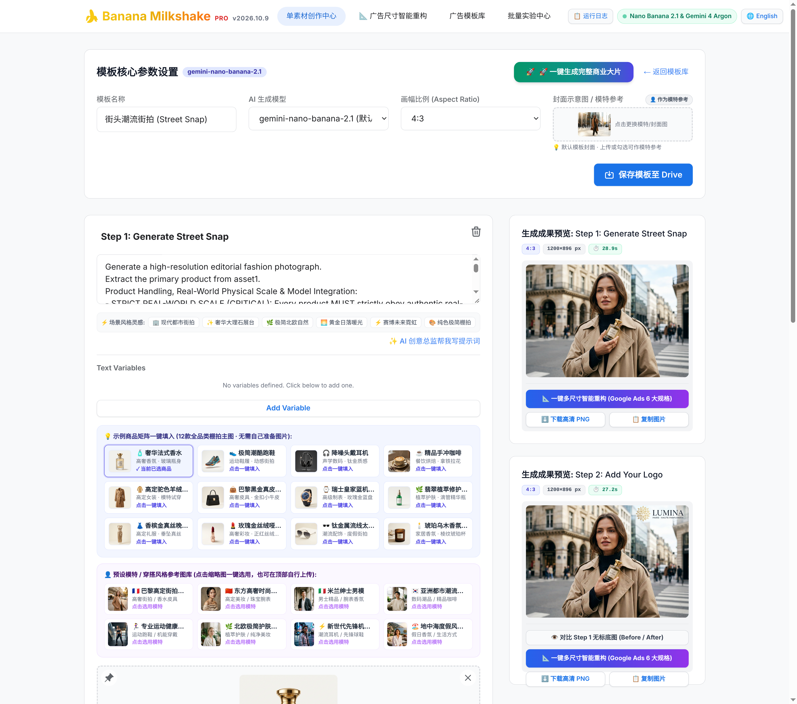
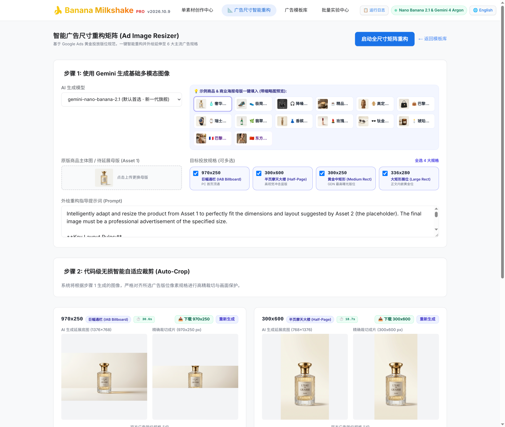
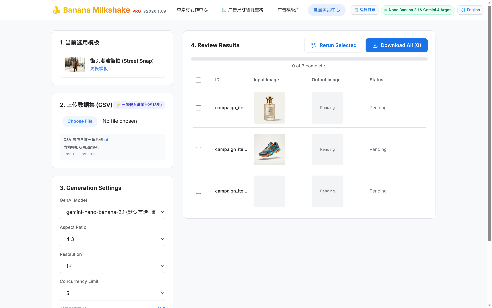
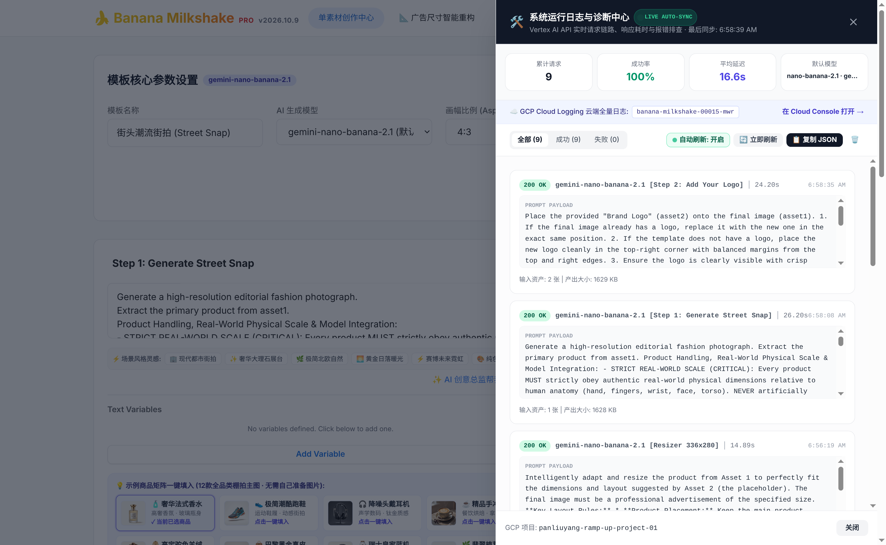

<!--
Copyright 2026 Google LLC

Licensed under the Apache License, Version 2.0 (the "License");
you may not use this file except in compliance with the License.
You may obtain a copy of the License at

      https://www.apache.org/licenses/LICENSE-2.0

Unless required by applicable law or agreed to in writing, software
distributed under the License is distributed on an "AS IS" BASIS,
WITHOUT WARRANTIES OR CONDITIONS OF ANY KIND, either express or implied.
See the License for the specific language governing permissions and
limitations under the License.
-->

# 🍌 Banana Milkshake Pro

[](https://banana-milkshake.panlydns.com/)
[](https://banana-milkshake.panlydns.com/)
[](https://banana-milkshake.panlydns.com/)

**Banana Milkshake Pro** 是面向零售电商、高定时尚、美妆护肤与品牌营销团队打造的企业级多模态 AI 广告创意工作台（基于 Google Marketing Solutions 开源方案深度增强）。平台原生集成 **Nano Banana 2.1 (`gemini-nano-banana-2.1`)** 商业视觉生成引擎与 **Gemini 4 Argon (`gemini-4-argon`)** 创意总监推理模型，支持**免登录零冷启动**一键生成棚拍级商业海报、**Google Ads 6 大黄金投放规格智能外绘重构**，以及**百倍规模 CSV 批量素材量产**。

🔗 **在线体验 (Live Production Demo)**: [https://banana-milkshake.panlydns.com/](https://banana-milkshake.panlydns.com/)

---

## ✨ 核心特性 (Key Highlights)

- **🎨 双核驱动（Nano Banana 2.1 + Gemini 4 Argon）**
  - **视觉生成底座**：默认搭载 `gemini-nano-banana-2.1`（同时支持切换 `gemini-3.1-flash-image`、`gemini-3-pro-image`、`gemini-3.1-flash-lite-image`、`gemini-2.5-flash-image`），精准遵循真实掌心物理比例（8–12cm 单手自然握持 + 85mm 中近景构图）。
  - **AI 创意总监 (`gemini-4-argon`)**：内置最新发布的 **Gemini 4.0 Argon** 模型，一键分析情绪板/样图并自动撰写影视级商业摄影提示词。
- **⚡ 零冷启动开箱即用 (Zero-Cold-Start Experience)**
  - 预置 **9 大高转化垂直行业广告模板**、**12 款全品类高清商品白底主图**（高奢香氛、潮酷跑鞋、头戴耳机、手冲咖啡、羊绒大衣、真皮手袋、机械腕表、植萃精华、真丝晚礼服、丝绒口红、飞行员墨镜、琥珀香氛蜡烛）、**8 款全球模特/穿搭参考图** 与 **8 款纯透明底高奢品牌金标 Logo**。
- **📐 智能广告尺寸重构矩阵 (Ad Image Resizer Matrix)**
  - 将任意单张商品图或生成海报一键智能外绘（Outpainting）并配合客户端 Pica Lanczos3 代码级无损自适应裁切（Auto-Crop），直出 `970×250`、`300×600`、`300×250`、`336×280`、`160×600`、`728×90` 等 IAB / Google Ads 标准投放规格。
- **🛠️ 实时运行日志与诊断中心 (Live Auto-Sync Diagnostics)**
  - 右上角内置实时诊断抽屉，支持 **1.5s 自动轮询**、`102 RUNNING` 进行中任务动态计时、Prompt 载荷审查及一键跳转 GCP Cloud Logging。
- **🌐 中英双语响应式交互 (Bilingual i18n)**
  - 原生支持简体中文与英文一键无感切换，全平台免登录即可生成、预览与打包下载高清 PNG / ZIP 物料。

---

## 📸 界面与实测截图 (Product Screenshots)

### 1. 广告创意模板库 (`Template Library`)
精选时尚服饰、美妆护肤、电商零售及尺寸重构等垂直行业模板，提供 30 秒新手引导与一键极速体验通道：


### 2. 单素材创作中心 — 全链路两步生成 (`Creation Studio`)
支持一键载入 12 款全品类示例商品、8 款预设模特参考及 6 大场景灵感芯片；**Step 1** 生成符合真实物理比例的模特街拍底图，**Step 2** 自动在右上角融合纯透明底品牌金标并支持 Before/After 一键对比：



### 3. 智能广告尺寸重构矩阵 (`Ad Image Resizer Matrix`)
采用「AI 外绘延展底图 + 代码级精确像素裁切」双阶段流水线，一键将单张主图扩展为多尺寸 Google Ads 标准投放矩阵：



### 4. 批量广告创意生成与实验中心 (`Bulk Creation & Experimentation`)
支持通过 CSV 数据集批量注入不同商品资产、文案卖点与 CTA 变量，并可自由调节并发 Worker 线程池规模：



### 5. 系统运行日志与实时诊断中心 (`Live Diagnostics Console`)
实时监控 `gemini-4-argon` 与 `gemini-nano-banana-2.1` 的请求状态（`102 RUNNING` / `200 OK`）、端到端耗时、输出大小及完整 Prompt 载荷：



---

## 🧠 模型配置架构 (Model Stack)

| 模块职责 | 默认模型 ID | 可选 / 兼容模型 | 说明 |
| :--- | :--- | :--- | :--- |
| **AI 创意总监 / 提示词推理** | `gemini-4-argon` | `gemini-4-argon` | 最新 **Gemini 4.0 Argon** 模型，负责视觉风格解构与商业摄影 Prompt 创作 |
| **多模态商业生图与品牌合成** | `gemini-nano-banana-2.1` | `gemini-3.1-flash-image`<br>`gemini-3-pro-image`<br>`gemini-3.1-flash-lite-image`<br>`gemini-2.5-flash-image` | 负责高定街拍生成、多图层 Logo 融合与多比例外绘重构 |

---

## 🚀 本地开发与部署指南 (Development & Deployment)

### 1. 环境变量配置 (`Environment Variables`)

在项目根目录与 `server/` 目录下配置 `.env` 文件：

```dotenv
PORT=3001
GOOGLE_CLOUD_PROJECT="your-gcp-project-id"
GOOGLE_CLOUD_LOCATION="global"
USE_VERTEX_AI=true
DEFAULT_TEXT_MODEL="gemini-4-argon"
DEFAULT_IMAGE_MODEL="gemini-nano-banana-2.1"
```

### 2. 本地一键启动 (`Run Locally`)

```bash
# 安装前端依赖
npm install

# 安装后端代理服务依赖
cd server && npm install && cd ..

# 同时启动前后端开发服务 (Frontend: :3000, Backend: :3001)
npm run start:all
```

### 3. 部署至 Google Cloud Run (`Deploy to Cloud Run`)

```bash
gcloud run deploy banana-milkshake \
  --source . \
  --region=us-central1 \
  --project=your-gcp-project-id \
  --allow-unauthenticated \
  --set-env-vars="GOOGLE_CLOUD_PROJECT=your-gcp-project-id,GOOGLE_CLOUD_LOCATION=global,USE_VERTEX_AI=true,DEFAULT_TEXT_MODEL=gemini-4-argon,DEFAULT_IMAGE_MODEL=gemini-nano-banana-2.1"
```

---

## 📄 开源许可 (License)

本项目基于 [Apache 2.0 License](LICENSE) 开源。
